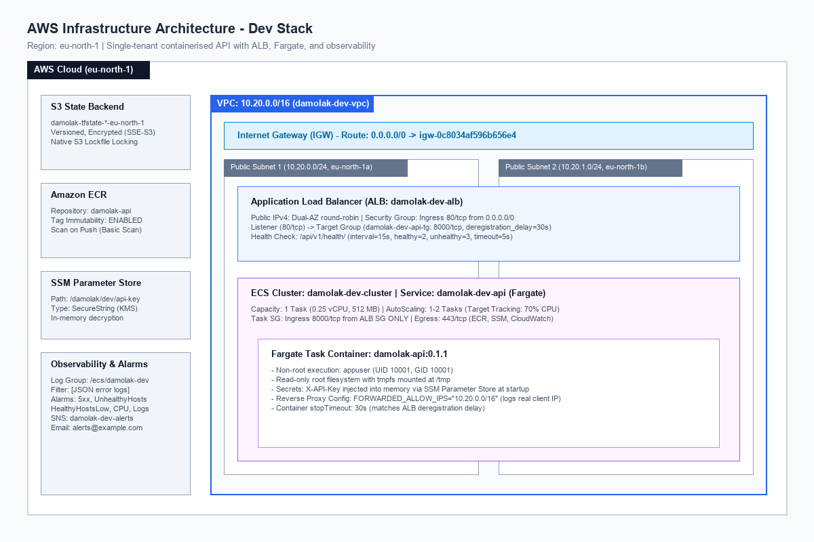
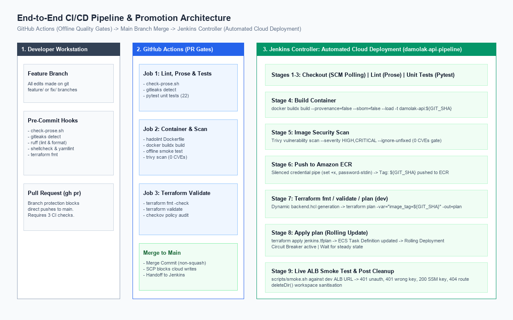

# ECS Platform Challenge

[](https://github.com/Legacy-G/ecs-pc-platform/actions/workflows/ci.yml)

Production-ready container platform deploying an authenticated FastAPI telemetry and echo microservice to AWS ECS Fargate behind an Application Load Balancer in region `eu-north-1`.

---

## Architecture Overview

The platform provisions an isolated, multi-AZ network architecture hosting containerised workloads on AWS ECS Fargate:

- **Compute:** AWS ECS Fargate running Linux AMD64 containers with read-only root filesystems, tmpfs mounted at `/tmp`, and execution constrained to unprivileged user `appuser` (UID 10001).
- **Networking:** Custom VPC (`10.20.0.0/16`) spanning two Availability Zones (`eu-north-1a`, `eu-north-1b`) with public subnets for external load balancing and direct egress.
- **Traffic Routing:** Application Load Balancer with independent HTTP target group, active health checks, and a default 404 listener for unrouted requests.
- **Secrets Management:** Sensitive API keys stored in AWS Systems Manager (SSM) Parameter Store as `SecureString` parameters and injected into memory at runtime without entering Terraform state.
- **Observability:** Centralized CloudWatch log group (`/ecs/damolak-dev`), structured JSON logging, 5 CloudWatch metric alarms, and an Amazon SNS topic for automated operator alerts.



---

## Repository Map

```text
.
├── .github/
│   ├── dependabot.yml            # Weekly dependency updates (Docker, Pip, Terraform, Actions)
│   └── workflows/ci.yml          # Credential-free GitHub Actions verification pipeline
├── ci/
│   ├── jenkins/                  # Pinned LTS Jenkins controller with JCasC and plugins
│   │   ├── Dockerfile            # Jenkins controller image with CLI tooling
│   │   ├── docker-compose.yml    # Controller daemon bound to 127.0.0.1:8088
│   │   ├── jenkins.yaml          # Jenkins Configuration as Code definition
│   │   └── plugins.txt           # Explicitly pinned Jenkins plugins
│   └── versions.env              # Pinned tool, base image, and provider versions
├── docs/
│   ├── adr/                      # Architecture Decision Records (0001 - 0007)
│   ├── architecture/             # Diagrams as code (Python generator, SVG, PNG)
│   ├── evidence/                 # Sanitised validation evidence across project phases
│   ├── HUMAN_STEPS.md            # Operator procedures requiring human credentials
│   ├── REQUIREMENTS.md           # Traceability matrix mapping requirements to evidence
│   └── RUNBOOK.md                # Operations, monitoring, recovery drills, and teardown
├── infra/
│   ├── bootstrap/                # S3 state bucket with native lockfile locking
│   ├── envs/
│   │   ├── dev/                  # Development stack (VPC, ALB, ECS, Observability)
│   │   ├── prod/                 # Production stack (Plan-only target)
│   │   └── shared/               # Shared resources (ECR, Budgets, CI IAM User)
│   └── modules/                  # Reusable Terraform modules (alb, ecs-service, network, etc.)
├── scripts/                      # Operational scripts (bootstrap, cost check, smoke tests)
├── services/
│   └── api/                      # FastAPI application with tests and Dockerfile
├── docker-compose.yml            # Local development orchestration
├── Jenkinsfile                   # Declarative pipeline for automated cloud deployments
└── Makefile                      # Standard operator targets and lifecycle commands
```

---

## Prerequisites

- **Docker Desktop** (or Docker Engine with Compose)
- **Terraform** >= 1.10.0
- **AWS CLI v2** configured with `damolak` profile in `eu-north-1`
- **Python** >= 3.12 with `pip`
- **GitHub CLI** (`gh`)

---

## Deployment Steps

Follow these steps to replicate the environment from scratch.

### 1. Bootstrap State Backend

Generate the local backend configuration and initialize S3 state storage:

```bash
make bootstrap
```

This provisions `damolak-tfstate-<ACCOUNT_ID>-eu-north-1` with S3 native lockfile locking, encryption, and versioning.

### 2. Deploy Shared Platform Stack

Provision the shared Amazon ECR repository, AWS Budgets guardrail, and Jenkins CI IAM credentials:

```bash
terraform -chdir=infra/envs/shared init -backend-config=backend.hcl
terraform -chdir=infra/envs/shared apply -auto-approve
```

### 3. Generate Secret API Key in SSM

Create the `SecureString` secret parameter in SSM Parameter Store without exposing the secret to Terraform:

```bash
AWS_PROFILE=damolak AWS_REGION=eu-north-1 bash scripts/create-api-key.sh dev
```

### 4. Build and Push Initial Image

Build the container image with provenance disabled and push to Amazon ECR:

```bash
GIT_SHA=$(git rev-parse --short HEAD)
ACCOUNT_ID=$(aws sts get-caller-identity --query Account --output text)
REGISTRY="${ACCOUNT_ID}.dkr.ecr.eu-north-1.amazonaws.com"

aws ecr get-login-password --region eu-north-1 | docker login --username AWS --password-stdin "${REGISTRY}"
docker buildx build --platform linux/amd64 --provenance=false --sbom=false --load -t "damolak-api:${GIT_SHA}" -f services/api/Dockerfile services/api
docker tag "damolak-api:${GIT_SHA}" "${REGISTRY}/damolak-api:${GIT_SHA}"
docker push "${REGISTRY}/damolak-api:${GIT_SHA}"
```

### 5. Deploy Development Application Stack

Deploy the networking, load balancer, CloudWatch alarms, and ECS Fargate service:

```bash
terraform -chdir=infra/envs/dev init -backend-config=backend.hcl
terraform -chdir=infra/envs/dev apply -var="image_tag=${GIT_SHA}" -var="git_sha=${GIT_SHA}" -var="app_version=0.1.1" -auto-approve
```

### 6. Verify Deployment

Execute the end-to-end smoke test against the live Application Load Balancer:

```bash
ALB_URL=$(terraform -chdir=infra/envs/dev output -raw service_url)
bash scripts/smoke.sh "${ALB_URL}" "${GIT_SHA}" "/damolak/dev/api-key"
```

---

## CI/CD Architecture & Pipeline Flow

The deployment lifecycle uses a two-tier approach separating pull-request quality gates from deployment execution:

1. **GitHub Actions (CI Only):** Runs offline linting (`check-prose`, `ruff`), security scanning (`gitleaks`, `hadolint`, `trivy`), unit tests (`pytest`), and Terraform format/validation. It contains zero AWS credentials and cannot write to cloud infrastructure.
2. **Jenkins Controller (CD & Deployment):** Runs as a local Docker container (`127.0.0.1:8088`) executing declarative builds on changes merged to `main`. It authenticates to AWS via a dedicated IAM user (`damolak-jenkins-ci`) restricted by an explicit Permissions Boundary.



### Why GitHub Actions Does Not Deploy (SCP Restriction)
The AWS account sits within an AWS Organization whose Service Control Policy (SCP) explicitly denies `iam:CreateOpenIDConnectProvider`. Because GitHub Actions cannot assume IAM roles via OIDC and long-lived cloud credentials must not be stored in third-party services, all cloud deployments are executed by the local Jenkins controller. See [ADR 0007](docs/adr/0007-github-actions-ci-only-scp-oidc-block.md) for full architectural context.

---

## Monitoring, Logs & Alarms

- **Structured Logs:** Containers emit JSON logs to stdout. View live logs with AWS CLI:
  ```bash
  aws logs tail /ecs/damolak-dev --region eu-north-1 --follow
  ```
- **Operational Dashboard:** Inspect metrics on the CloudWatch dashboard `damolak-dev-overview`.
- **Active Alarms:** Five CloudWatch alarms protect the service:
  1. `damolak-dev-alb-5xx`: Fires when ALB 5xx error count exceeds 0.
  2. `damolak-dev-unhealthy-hosts`: Fires when Target Group UnHealthyHostCount >= 1.
  3. `damolak-dev-healthy-hosts-low`: Fires when Target Group HealthyHostCount < 1.
  4. `damolak-dev-cpu-high`: Fires when ECS CPU utilization exceeds 85% for 3 periods.
  5. `damolak-dev-app-log-errors`: Fires when structured JSON application errors exceed 0 in 1 minute.

---

## Design Decisions & Architecture Decision Records (ADRs)

| Decision | Context & Justification | ADR Reference |
| :--- | :--- | :--- |
| **Compute Engine** | AWS ECS Fargate provides fully managed serverless containers without EC2 cluster maintenance overhead. | [ADR 0001](docs/adr/0001-record-architecture-decisions.md) |
| **Process Model** | Single Uvicorn worker process per container aligns task health directly with container liveness. | [ADR 0002](docs/adr/0002-fastapi-single-uvicorn-worker.md) |
| **State Storage** | S3 bucket with native lockfile locking provides distributed concurrency protection without DynamoDB tables. | [ADR 0003](docs/adr/0003-terraform-state-and-iam-scoping.md) |
| **Network Architecture** | Fargate tasks run in public subnets with direct egress to avoid NAT Gateway hourly charges (USD 0.059/hr). | [ADR 0004](docs/adr/0004-network-topology-and-private-subnets.md) |
| **Telemetry Costs** | ECS Container Insights is disabled to eliminate custom metric charges and remain within Free Tier credits. | [ADR 0005](docs/adr/0005-disable-ecs-container-insights.md) |
| **Decoupled ALB** | Load balancer is extracted into an independent module with a default 404 rule to support multi-service growth. | [ADR 0006](docs/adr/0006-decoupled-alb-and-multi-service-routing.md) |
| **CI Security** | Jenkins performs cloud deployment while GitHub Actions remains CI-only due to AWS Organization SCP denials. | [ADR 0007](docs/adr/0007-github-actions-ci-only-scp-oidc-block.md) |

---

## Assumptions, Limitations & Future Improvements

### Security Limitations & Upstream Vulnerabilities
- **ECR Basic Scan Findings:** Amazon ECR basic scanning reports 9 HIGH severity vulnerabilities originating from standard Debian 12 (bookworm) base packages (`util-linux`, `zlib`, `glibc`, `sqlite3`). As confirmed against the Debian Security Tracker, none of these packages currently have patches published by upstream maintainers. Trivy container scanning with `--ignore-unfixed` reports 0 vulnerabilities. Base images are refreshed weekly through Dependabot.
- **HTTP-Only Listener:** The current ALB listener operates on HTTP port 80. In production, configure an AWS Certificate Manager (ACM) TLS certificate with an HTTPS listener (port 443) and an HTTP-to-HTTPS redirect rule.
- **Single Task Availability Gap:** In development (`desired_count = 1`), task replacement creates an availability gap of ~59 seconds while Fargate provisions an ENI and passes health checks. Production requires `desired_count >= 2`.

### Future Roadmap
1. **HTTPS and ACM:** Provision Route 53 DNS records and validate ACM certificates for encrypted ingress.
2. **AWS WAF:** Attach AWS WAF to the ALB to inspect payloads and enforce IP rate limiting.
3. **Private Subnets with VPC Endpoints:** Relocate Fargate tasks to private subnets using AWS PrivateLink endpoints for ECR, SSM, and CloudWatch without deploying costly NAT Gateways.
4. **Multi-Environment Promotion:** Expand pipeline to promote images from `dev` to `staging` and `prod` with approval gates.
5. **Persistent Storage:** Integrate Amazon Aurora PostgreSQL Serverless v2 for stateful relational workloads.

---

## Cost Analysis & Teardown

### Running Cost (`eu-north-1`)

| Resource | Hourly Rate (USD) | Monthly Rate (USD) | Notes |
| :--- | :--- | :--- | :--- |
| **Application Load Balancer** | $0.0225 | $16.20 | Base hourly charge |
| **ALB Public IPv4 Addresses (2)** | $0.0100 | $7.20 | $0.005/hr per public IP |
| **ALB LCU (Light Traffic)** | $0.0080 | $5.76 | Baseline evaluation |
| **Fargate Task (0.25 vCPU, 0.5 GB)** | $0.0119 | $8.57 | Compute and memory |
| **Fargate Public IPv4 Address** | $0.0050 | $3.60 | Public subnet assignment |
| **Total Dev Rate** | **$0.0574/hr** | **~$41.33/mo** | ~$1.38/day |

### Complete Teardown Procedure

To stop all hourly charges:

```bash
# Destroy dev environment
terraform -chdir=infra/envs/dev destroy -auto-approve

# Destroy shared resources
terraform -chdir=infra/envs/shared destroy -auto-approve

# Confirm zero billable resources remain
AWS_PROFILE=damolak AWS_REGION=eu-north-1 bash scripts/cost-check.sh
```

---

## Evidence Index

All project evidence files are stored with commit SHAs and UTC timestamps:

- **Phase 1 (Containerisation & Local Quality):** [docs/evidence/phase1/](docs/evidence/phase1/)
- **Phase 2 (Terraform Architecture & Offline Verification):** [docs/evidence/phase2/](docs/evidence/phase2/)
- **Phase 3A (Bootstrap, ECR Push & CVE Findings):** [docs/evidence/phase3a/](docs/evidence/phase3a/)
- **Phase 3B (Dev Rollout, ALB Smoke Test & Alarms):** [docs/evidence/phase3b/](docs/evidence/phase3b/)
- **Phase 4 (Jenkins CI/CD Pipeline & Proof Deployment):** [docs/evidence/phase4/](docs/evidence/phase4/)
- **Phase 5 (Idempotency Plans, Alarm Drill & Task Recovery):** [docs/evidence/phase5/](docs/evidence/phase5/)
